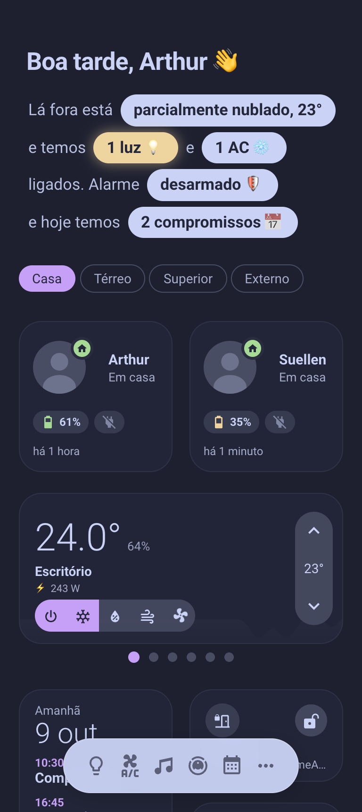
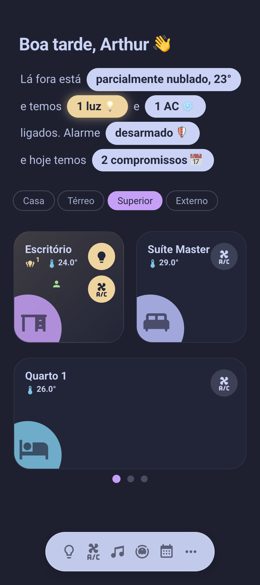

# My Home Assistant config

YAML packages for the automations, sensors and scripts, plus a phone-first dashboard ("Casa") in the Catppuccin palette.
The interface is in Brazilian Portuguese; everything else is in English.

 

## Layout

| Path | What lives there |
|---|---|
| `configuration.yaml` | Core config |
| `packages/areas/` | One file per room or outdoor area |
| `packages/core/` | Notifications and other plumbing the rest builds on |
| `packages/modes/` | House mode (day, night, away) |
| `packages/modules/` | Features that span rooms |
| `packages/routines/` | Time- and event-driven routines |
| `dashboards/` | The Casa dashboard: views, pop-ups and card templates (one file per template under `dashboards/templates/`). Room cards and pop-ups are built from the Home Assistant areas (name, icon, temperature, lights, ACs, occupancy sensor), so a new sensor or light needs no dashboard change, only its area |
| `custom_templates/` | Shared Jinja macros |
| `themes/` | The Catppuccin theme |
| `www/` | Bubble Card modules |

`automations.yaml`, `scripts.yaml` and `scenes.yaml` are the files the UI writes to; the logic is in `packages/`.

## Requirements

Installed from [HACS](https://hacs.xyz) on the instance, not included here.

Dashboard cards and theme:
[Bubble Card](https://github.com/Clooos/Bubble-Card),
[button-card](https://github.com/custom-cards/button-card),
[streamline-card](https://github.com/brunosabot/streamline-card),
[auto-entities](https://github.com/thomasloven/lovelace-auto-entities),
[layout-card](https://github.com/thomasloven/lovelace-layout-card),
[card-mod](https://github.com/thomasloven/lovelace-card-mod),
[Paper Buttons Row](https://github.com/jcwillox/lovelace-paper-buttons-row),
[Advanced Camera Card](https://github.com/dermotduffy/advanced-camera-card),
[Sonos Card](https://github.com/punxaphil/custom-sonos-card),
[Mini Media Player](https://github.com/kalkih/mini-media-player),
[mini-graph-card](https://github.com/kalkih/mini-graph-card),
[Weather Forecast Card](https://github.com/troinine/ha-weather-forecast-card),
[Weather Radar Card](https://github.com/jpettitt/weather-radar-card),
[Simple Tabs](https://github.com/agoberg85/home-assistant-simple-tabs),
[Todo List Card](https://github.com/agoberg85/home-assistant-todo-card),
[MySmart Floating Navbar](https://github.com/agoberg85/mysmart-floating-navbar),
[CSS-Swipe-Card](https://github.com/Nemuritor01/css-swipe-card),
[Kiosk Mode](https://github.com/NemesisRE/kiosk-mode),
[Catppuccin theme](https://github.com/catppuccin/home-assistant).

Integrations:
[SmartThings Extra](https://github.com/mik-laj/ha_smartthing_extra),
[Microsoft Edge TTS](https://github.com/hasscc/hass-edge-tts),
[Music Assistant Queue Actions](https://github.com/droans/mass_queue),
[Verisure OWA](https://github.com/guerrerotook/securitas-direct-new-api),
[Tarifas de Energia Brasil](https://github.com/vodikus/ha_tarifas_energia_brasil).

## Setup

- `secrets.yaml` is git-ignored: copy `secrets.yaml.example` and fill it in. It holds `external_url`, `ha_diagnostics_token`, `internal_url`.
- `nix develop` (or direnv) installs the git hooks: yamlfmt, nixfmt and gitleaks run before each commit.
